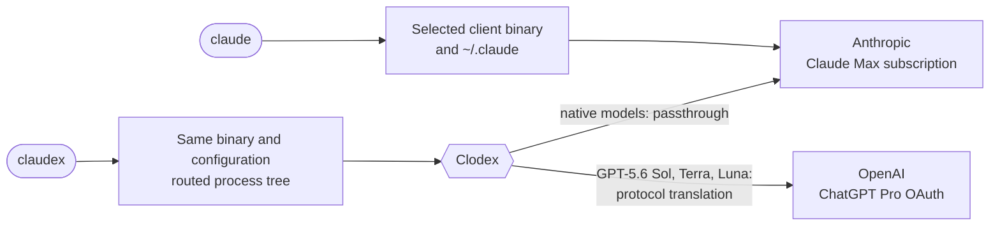

# Subscription routing setup

This package reproduces a two-subscription setup without placing provider API keys in the client configuration:



`claudex` is an opt-in launcher for an isolated Clodex route. Clodex handles provider OAuth, native-model passthrough, protocol translation, and lifecycle logging. A normal `claude` launch remains on its direct Anthropic path. Routing does not replace normal login, settings, plugins, skills, agents, session history, or project configuration.

cc-enhanced is a **standard marketplace plugin** with `install.sh` and a shell PATH wrapper. Claude Code remains official and updates itself. The plugin resolves explicitly requested per-worker aliases at `agent.spawn` using the routed launcher's `CC_ENHANCED_AGENT_ROUTING_CONFIG` file. It does not supply a model picker/catalog, context-window overrides, an expanded Agent schema, or child network-environment changes. The [legacy patcher revision](../../README.md#what-changed-from-the-legacy-patcher) retains the old setup for historical reference.

The templates retain model shortcuts, prompt composition, process wrapping, credential isolation, and guarded service restarts. Shortcuts do not add aliases to the stock picker or built-in tool schemas. Per-worker alias resolution uses the config's `modelAliases` entries and canonical `clodex:<providerId>:<modelId>` IDs. This plugin path does not require Clodex client patching.

`clodex patch` is a Clodex operation, not part of cc-enhanced. If you need it, use a separately managed Claude Code installation and follow Clodex's current compatibility requirements. Do not modify the official executable used with cc-enhanced: doing so invalidates stock-binary verification and can be overwritten by Claude Code's own updater. The administration wrapper delegates Clodex commands; it no longer detects an enhanced profile or rejects patching on your behalf.

This setup targets WSL or Linux x86_64 with a systemd user session. The service and supplied Windows PasswordVault bridge are platform-specific. A source-level template check does not establish live provider, alias, Agent, or Workflow compatibility.

## Prerequisites

Install:

- Git and [mise](https://mise.jdx.dev/);
- a systemd user session and common POSIX utilities, including GNU `timeout` for inference smoke tests;
- `jq`;
- Windows PowerShell and `wslpath` when using the supplied WSL PasswordVault helper.

## 1. Select the client command

Confirm the intended client works directly:

```sh
claude --version
claude
```

For the standard cc-enhanced plugin and shell wrapper, follow [Getting started](../getting-started.md). If Clodex client changes are required, select a separate installation before rendering the routing launchers. The render recipe captures `command -v claude`; inspect that value before installation so it does not point at the wrong client. With cc-enhanced's PATH block loaded, that command selects its prompt wrapper rather than replacing the official executable.

Run the remaining setup commands from this `docs/subscription-routing` directory. No `CLAUDEX_CLIENT_PROFILE` variable is needed.

## 2. Install Clodex globally with mise

```sh
mise use -g node@lts
mise use -g --minimum-release-age 0 npm:@bman654/clodex@latest
mise tool npm:@bman654/clodex
mise which clodex
mise which clodex-claude
```

`mise use -g` installs Node.js and Clodex in the global mise configuration, so the commands are available anywhere mise is activated.

## 3. Select and install a credential helper

For WSL with Windows PasswordVault:

```sh
(
set -eu

install -d -m 700 "$HOME/.local/libexec"
install -m 700 templates/claudex-credential-helper \
  "$HOME/.local/libexec/claudex-credential-helper"
install -m 600 templates/claudex-credential-helper.ps1 \
  "$HOME/.local/libexec/claudex-credential-helper.ps1"
)
```

For native Linux or macOS, provide an equivalent executable backed by Secret Service, KWallet, Keychain, `pass`, or another secure store:

```sh
export CLODEX_CREDENTIAL_HELPER_PATH=/absolute/path/to/secure-helper
```

The helper must implement `get`, `set`, and `delete` operations. Use the same absolute path during rendering and verification. Do not use a plaintext token file.

## 4. Render the service and launchers

This example defaults to the supplied WSL helper but accepts the absolute `CLODEX_CREDENTIAL_HELPER_PATH` override:

```sh
(
set -eu

mise_data_dir=${MISE_DATA_DIR:-"$HOME/.local/share/mise"}
mise_shims_dir="$mise_data_dir/shims"
PATH="$mise_shims_dir:$PATH"
export PATH

node_bin=$(mise which node)
clodex_bin=${CLODEX_BIN_PATH:-$(command -v clodex)}
clodex_wrapper=$(command -v clodex-claude)
claude_bin=$(command -v claude)
credential_helper=${CLODEX_CREDENTIAL_HELPER_PATH:-"$HOME/.local/libexec/claudex-credential-helper"}
launcher_process_wrapper="$HOME/.local/libexec/claudex-process-wrapper"
prompt_composer="$HOME/.local/libexec/claudex-compose-system-prompt"

case "$credential_helper" in
  /*) ;;
  *) printf '%s\n' 'credential helper path must be absolute' >&2; exit 1 ;;
esac
test -x "$node_bin"
test -x "$clodex_bin"
test -x "$clodex_wrapper"
test -x "$claude_bin"
test -x "$credential_helper"

if ! systemctl --user is-active --quiet claudex-clodex.service; then
  "$node_bin" - 3457 <<'NODE'
const net = require('node:net');
const port = Number(process.argv[2]);
const server = net.createServer();
server.once('error', error => {
  process.stderr.write(`port ${port} is unavailable: ${error.message}\n`);
  process.exitCode = 1;
});
server.listen({ host: '127.0.0.1', port, exclusive: true }, () => server.close());
NODE
fi

rendered_dir=$(mktemp -d)
trap 'rm -rf "$rendered_dir"' 0 HUP INT TERM

sed \
  -e "s|@HOME@|$HOME|g" \
  -e "s|@CLODEX_BIN@|$clodex_bin|g" \
  -e "s|@CLODEX_CREDENTIAL_HELPER@|$credential_helper|g" \
  templates/claudex-clodex.service >"$rendered_dir/claudex-clodex.service"
sed \
  -e "s|@CLODEX_BIN@|$clodex_bin|g" \
  -e "s|@CLAUDE_BIN@|$claude_bin|g" \
  -e "s|@CLODEX_CREDENTIAL_HELPER@|$credential_helper|g" \
  templates/clodex >"$rendered_dir/clodex"
sed \
  -e "s|@CLODEX_BIN@|$clodex_bin|g" \
  -e "s|@CLODEX_CLAUDE_BIN@|$clodex_wrapper|g" \
  templates/clodex-service >"$rendered_dir/clodex-service"
sed \
  -e "s|@CLODEX_CLAUDE_BIN@|$clodex_wrapper|g" \
  templates/claudex-process-wrapper >"$rendered_dir/claudex-process-wrapper"
sed \
  -e "s|@NODE_BIN@|$node_bin|g" \
  -e "s|@CLAUDE_BIN@|$claude_bin|g" \
  -e "s|@CLODEX_CLAUDE_BIN@|$clodex_wrapper|g" \
  -e "s|@CLAUDEX_PROCESS_WRAPPER@|$launcher_process_wrapper|g" \
  -e "s|@CLAUDEX_PROMPT_COMPOSER@|$prompt_composer|g" \
  -e "s|@CLODEX_BIN@|$clodex_bin|g" \
  -e "s|@CLODEX_CREDENTIAL_HELPER@|$credential_helper|g" \
  templates/claudex >"$rendered_dir/claudex"

install -d -m 700 "$HOME/.local/share/claudex-clodex"
install -d -m 700 \
  "$HOME/.config/systemd/user" \
  "$HOME/.local/bin" \
  "$HOME/.local/libexec"
install -m 600 "$rendered_dir/claudex-clodex.service" \
  "$HOME/.config/systemd/user/claudex-clodex.service"
install -m 700 "$rendered_dir/claudex" "$HOME/.local/bin/claudex"
install -m 700 "$rendered_dir/clodex" "$HOME/.local/bin/clodex"
install -m 700 "$rendered_dir/clodex-service" "$HOME/.local/bin/clodex-service"
install -m 700 "$rendered_dir/claudex-process-wrapper" \
  "$launcher_process_wrapper"
install -m 700 templates/claudex-compose-system-prompt \
  "$prompt_composer"

systemctl --user daemon-reload
)
```

Prepending the stable mise shims directory is intentional. The rendered files store version-independent shim paths, so installing a newer Clodex release changes the shim target without embedding the release number in the service or launchers.

The unit stays disabled. `claudex` starts it on demand; `claude` does not use it.

The service clears provider API keys, alternate provider base URLs, and routing overrides. Optional proxy or private-CA settings belong in:

```text
~/.config/claudex-clodex/network.env
```

The file may contain `HTTPS_PROXY`, `NO_PROXY`, or `NODE_EXTRA_CA_CERTS`. Keep it mode 600 and do not put provider API keys in it.

Use `network.env` when the entire routing service must inherit one proxy environment. For a route-scoped HTTP CONNECT proxy, leave those variables out of `network.env` and configure Clodex instead:

```sh
clodex upstream-proxy set "$UPSTREAM_PROXY_URL"
clodex upstream-proxy route anthropic on
clodex upstream-proxy route openai off
clodex upstream-proxy tools direct
clodex upstream-proxy status
```

The Anthropic and OpenAI proxy switches are independent. Child-tool modes describe Clodex policy: `tools original` requests the pre-bridge environment, `tools direct` clears proxy/bypass/CA settings, and `tools upstream` selects the upstream proxy. Their effect on a child process depends on the client integration that consumes Clodex's handoff; the cc-enhanced mod does not implement that behavior.

Provider-route changes take effect when the idle routing service next starts. Let routed sessions finish before using `clodex-service restart`; child-tool changes also require a fresh routed parent. Verify child network behavior on the actual selected client rather than assuming the former native behavior remains.

The launcher snapshots proxy, bypass, and CA variables into `CLODEX_ORIGINAL_NETWORK_ENV` before the bridge starts. This snapshot is preserved for Clodex, not a guarantee that stock Claude Code restores it for every child. Do not set the marker manually; the launcher owns and validates it.

## 5. Install and compose the routed prompt

The routed prompt is the managed `/etc/claude-code/system-prompt.md` plus the routing-specific policy. Install the reviewed overlay, then run the same composer that `claudex` invokes before every default launch:

```sh
(
set -eu

prompt_directory="$HOME/.config/claudex-clodex"
install -d -m 700 "$prompt_directory"
install -m 600 templates/system-prompt-routing.md \
  "$prompt_directory/routed-model-policy.md"
"$HOME/.local/libexec/claudex-compose-system-prompt"
)
```

Rerun this block when the routing template changes. Managed prompt changes are picked up automatically on the next `claudex` launch. The composer writes atomically, preserves an unchanged file without requiring write access to its directory, and fails closed when either source is unreadable. Set `CLAUDEX_SYSTEM_PROMPT_FILE` only when intentionally replacing the composed prompt for a launch; explicit replacements are not overwritten. The static verifier reconstructs the default file byte-for-byte.

The prompt is append-only and contains no credentials. It teaches parent and child contexts that an explicit worker-routing request means preserving the exact agent type from the current setup while applying `model` and `effort` only to the requested call. It does not create model-specific agent definitions or force every child onto one route.

## 6. Start, authenticate, and select the model

Start the service after the global Clodex tool and rendered unit are installed:

```sh
systemctl --user start claudex-clodex.service
clodex providers auth openai
clodex providers list
clodex models
```

In the model manager, favorite each routed model from provider `openai-oauth` and save its lowercase alias:

| Favorite        | Alias   |
| --------------- | ------- |
| `gpt-5.6-sol`   | `sol`   |
| `gpt-5.6-terra` | `terra` |
| `gpt-5.6-luna`  | `luna`  |

Saved favorites and aliases configure Clodex; they do not change stock Claude Code's model picker or Agent schema. cc-enhanced resolves per-worker aliases through `agent.spawn`, including Workflow calls. It does not inject provider context limits or a model catalog into the stock client. Do not run `clodex patch` against the official executable used with cc-enhanced; any separately managed client modification is outside this setup.

Keep provider credentials out of `~/.claude/settings.json`. Routing remains scoped to the routed process tree.

### Context limits

`claudex --max-context` and the older `--1m` spelling are rejected. The launcher no longer generates `CLAUDE_CODE_CONFIGURED_MODEL_CATALOG`, queries model metadata to set headroom, or advertises a larger context window to Claude Code.

Configure routed-model context in Clodex using the controls supported by your installed version. Check `clodex models --help` and provider/account limits rather than relying on the former enhanced catalog's values. Larger contexts can change cost and usage; this launcher does not impose a provider pricing boundary.

## 7. Verify

```sh
./verify-static.sh
./verify-live.sh
```

The scripts no longer take an enhanced/stock selector. Static verification checks rendered installation contracts; the live verifier checks the installed service and client setup. Neither substitutes for exercising the routed behaviors you depend on.

Opt-in direct, passthrough, and translated inference smoke tests:

```sh
./verify-live.sh --smoke
./verify-live.sh --smoke --model=terra
./verify-live.sh --smoke --model=luna
```

`--smoke` consumes subscription usage and checks one routed model per invocation. Use `--model=sol`, `--model=terra`, or `--model=luna` deliberately. It tests translation first, then direct Claude and routed Claude passthrough, stopping on the first failure and naming that stage. Each call has a 90-second deadline and session-only short timeout/no-retry settings. Calls run sequentially from an empty temporary workspace with a minimal prompt, no tools or MCP servers, no stdin, one turn, and no session persistence. Safe mode excludes user/project instructions, plugins, hooks, and memory while retaining authentication; administrator-managed policy can still apply. This checks provider transport, not plugin behavior. Use `bun run verify:mods --binary <stock-binary> --live` and the interactive probes for mod behavior.

Confirm each shortcut and any supported per-call Agent/Workflow routing on the selected client. Confirm a normal `claude` session still uses its direct route. Do not infer worker-model support from a successful top-level model call.

## Usage

```sh
claude                    # direct client; no routing environment
claudex                   # routed session; preserve the saved parent choice
claudex fable             # native-model passthrough shortcut
claudex opus              # native-model passthrough shortcut
claudex sol               # routed alias, when supported by the selected client
claudex terra
claudex luna
claudex --model <model-id> # explicit model instead of a shortcut
clodex providers list     # isolated provider administration
clodex models             # isolated favorites and aliases
clodex-service restart    # guarded restart after routed clients are idle
```

Do not combine a shortcut with an explicit `--model`. Routed prompt flags are managed by the wrapper; use `CLAUDEX_SYSTEM_PROMPT_FILE` for an intentional prompt replacement.

For per-worker routing, use Workflow `agent(prompt, { agentType: "security-reviewer", model: "luna", effort: "max" })`. The hook keeps the selected agent type and requested effort, rewriting only a configured alias into its canonical model ID. Full IDs, unknown models, omitted models, forks, and resumes keep stock behavior. The built-in Agent tool still restricts its `model` field to stock aliases; do not send routed aliases or arbitrary IDs there. Without Workflow, a normal agent definition can declare a full routed model ID. Do not replace the chosen specialist or change the parent model as a workaround.

The process wrapper selects the composed prompt for both contexts. Print mode uses stock append flags; interactive subagents receive additional message context from the cc-enhanced plugin. An explicit caller append takes precedence. `/model` selects the parent, not an individual worker. Local stub probes establish client routing and effort propagation, not paid-provider availability or protocol translation.

The launcher no longer overrides the auto-mode classifier model. Enabling auto mode does not establish that its classifier follows the routed parent; stock or separately integrated client behavior applies.

The isolated Clodex home is `~/.local/share/claudex-clodex`.

## Safe updates and restarts

Updating the globally activated Clodex tool changes the target selected by its mise shims, but it does not restart the running service or replace code that process already loaded. `Restart=on-failure` is not an upgrade watcher: systemd acts only after the service exits unsuccessfully. A bridge that remains alive while returning routed 5xx responses is still considered running.

Clodex loads provider adapters on demand. If mise removes the previous package version while its service is still running, a later routed request can try to load an adapter from that removed installation. Treat the tool upgrade and service restart as one maintenance operation. Let routed sessions finish, then run:

```sh
mise use -g --minimum-release-age 0 npm:@bman654/clodex@latest
mise reshim
mise tool npm:@bman654/clodex
mise which clodex
mise which clodex-claude
clodex --version
```

The version-specific `mise which` paths should change after an update; the installed service and launchers continue to point at stable shims. Reload systemd only when the unit template changed, then restart the idle service and verify the installation:

```sh
clodex-service restart
./verify-static.sh
./verify-live.sh
```

`claudex` holds a shared routed-session lock for the client lifetime. `clodex-service restart` acquires the matching exclusive lock before invoking systemd and refuses to restart while routed sessions are active. Do not bypass it with a direct `systemctl restart` during normal maintenance.

The unit remains disabled by design. A WSL shutdown stops the running user service; the next `claudex` launch starts it on demand. When the unit is inactive, no stale Clodex process remains loaded.

For a client update:

1. For the official Claude Code installation used with cc-enhanced, allow its own updater or run `claude update`. Plugin updates are separate: GitHub/git marketplace sources can auto-update; local-checkout users pull changes, run `claude plugin update cc-enhanced@cc-enhanced` or rerun `./install.sh`, then reload plugins or start a new session. Do not apply Clodex's client modification to that official executable.
2. For a separate Clodex-managed client, update it and follow Clodex's instructions for refreshing its integration.
3. Rerender the launchers if the mise data directory, credential-helper path, or selected client path changed.
4. Reinstall the routing overlay if its reviewed template changed.
5. Run static and live setup checks, then deliberately exercise any required provider and worker routes.

## Troubleshooting

### A routed model is missing from `/model`

Launch through `claudex` and run the static verifier. Stock Claude Code does not gain picker aliases from the cc-enhanced mod. If you use Clodex's separate client integration, check its compatibility and refresh instructions; do not patch the official executable used with cc-enhanced.

### The routed launcher is blank or slow

Check:

```sh
systemctl --user status claudex-clodex.service --no-pager
journalctl --user-unit claudex-clodex.service --since today --no-pager
```

If authentication remains invalid, rerun `clodex providers auth openai`. Do not print credential-helper output or set provider API-key variables.

### Saved aliases exist but requests fail

A running service, an `auth: helper (OAuth)` provider entry, or cached `clodex models --json` metadata does not prove that the serving route has a valid credential. Use `clodex models --list` to resolve live routes. An OpenAI token-refresh 401 requires interactive reauthentication with `clodex providers auth openai`; do not replace aliases or print credential-helper output to work around it. Anthropic rate-limit or usage-limit errors are separate from Clodex translation and require account availability before the direct and passthrough smoke stages can pass.

### Routed agents stay idle or return package-import 502s

A worker with only its initial message and no real assistant turn does not prove that its routed model is unavailable. Check whether translation failed before any provider request:

```sh
mise which clodex
clodex --version
systemctl --user show claudex-clodex.service \
  --property=ActiveState,SubState,MainPID,ExecMainStartTimestamp
jq -c 'select(.event == "translation_failed" or .event == "upstream_error")' \
  "$HOME/.local/share/claudex-clodex/logs/inference-requests.jsonl"
```

If the error says that a provider package cannot be found and names an older mise installation directory, the installed tool and loaded service diverged. No provider request was made; changing model aliases, OAuth credentials, or Claude Code effort settings will not repair it.

If the service is inactive, start a routed client with `claudex`; it will start the currently installed service on demand. If the service is active, close all routed clients and run `clodex-service restart`.

If an already-broken routed client cannot release the shared lock, a direct restart is an emergency recovery:

```sh
systemctl --user restart claudex-clodex.service
```

This interrupts every routed client and bypasses the normal safety guard. Use it only after accepting that impact, then rerun any workers that retained the synthetic error.

### The client reports `Unable to connect to API (ECONNRESET)`

Match the terminal timestamp to the lifecycle log:

```sh
jq -c 'select(
  .event == "response_failed"
  or .event == "translation_failed"
  or ((.event // "") | startswith("proxy_"))
)' "$HOME/.local/share/claudex-clodex/logs/inference-requests.jsonl"
```

Interpret the bounded diagnostic fields together:

- `response_failed` with `failureSource: "adapter_request_error"` and `errorCode: "ECONNRESET"` means the local proxy-to-adapter connection failed.
- `translation_failed` with `errorCode: "websocket_transport_error"` means the provider transport failed.
- `response_client_disconnected` with `terminationSource: "downstream_client"` means the client or worker cancelled the request.

### The context meter jumps at the start of a translated turn

If a translated turn still jumps by approximately the full prompt size and then falls when the response completes, update Clodex and use `clodex-service restart`. No cc-enhanced context override is required.

## Removal

Remove the provider first so Clodex can delete its OAuth credential through the configured helper:

```sh
(
set -eu

clodex providers remove openai-oauth
systemctl --user stop claudex-clodex.service
mise use -g --remove npm:@bman654/clodex
rm -f \
  "$HOME/.config/systemd/user/claudex-clodex.service" \
  "$HOME/.local/bin/claudex" \
  "$HOME/.local/bin/clodex" \
  "$HOME/.local/bin/clodex-service" \
  "$HOME/.local/libexec/claudex-process-wrapper" \
  "$HOME/.local/libexec/claudex-compose-system-prompt"
rm -rf \
  "$HOME/.config/claudex-clodex" \
  "$HOME/.local/share/claudex-clodex"
systemctl --user daemon-reload
)
```

Delete the supplied helper files only after provider removal confirms credential deletion. Removing this routed setup does not restore a separately modified client or alter normal Claude configuration or the Claude Max login. To remove cc-enhanced itself, run `./install.sh --uninstall` from its checkout. That removes its plugin, marketplace, shell blocks, and PATH wrapper, leaving saved settings and the official Claude Code installation in place.
